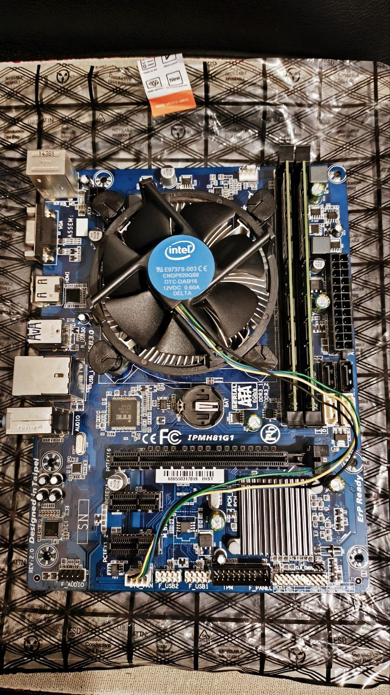
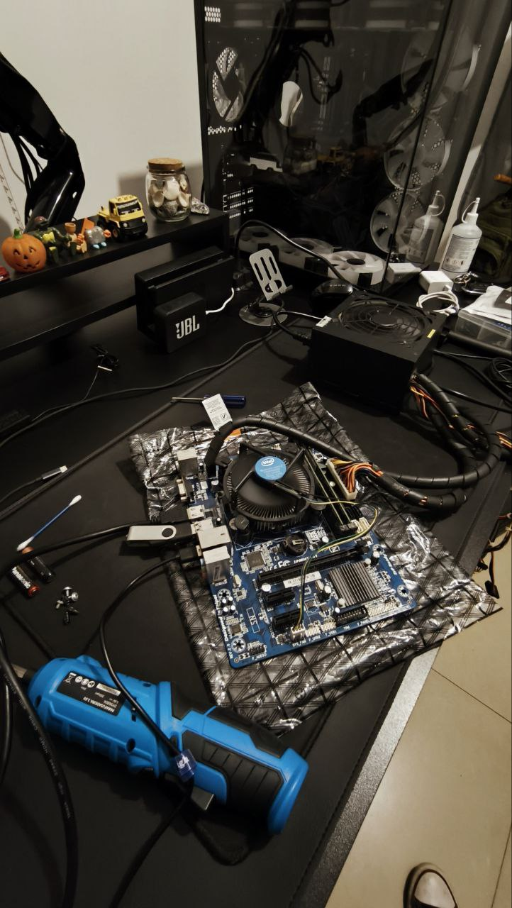
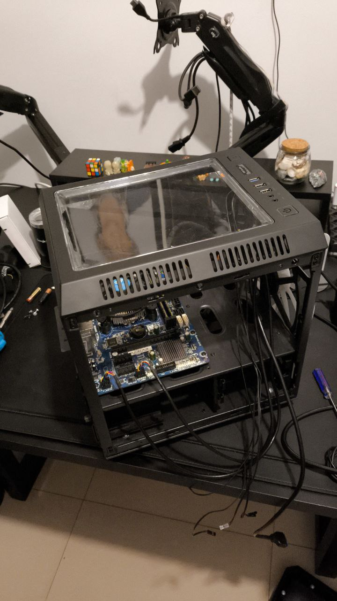
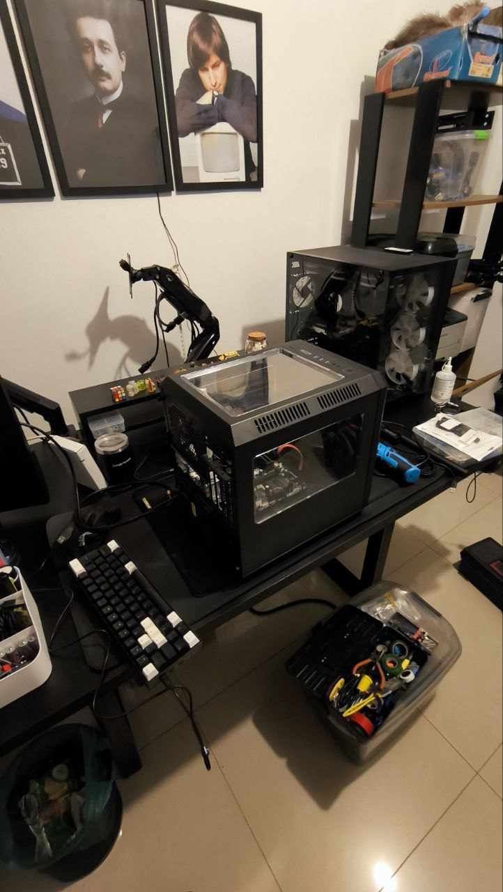

<h1 align="center">Servidor Caseiro de Baixo Custo</h1>

  
  
  
  

Este projeto visa a construção de um servidor doméstico econômico, com orçamento de **R$ 634,72**, utilizando a placa-mãe **IPMH81G1**. O objetivo é centralizar serviços de backup, sincronização de jogos, downloads via torrent e gerenciamento de containers Docker. O sistema contará com **dual boot** entre distribuições Linux e sistemas voltados para jogos, cada um instalado em discos rígidos separados.

---

## Imagens do Projeto

  <picture>
    <source srcset="img1.avif" type="image/avif" />
    <source srcset="img1.webp" type="image/webp" />
    
  </picture>
  <picture>
    <source srcset="img2.avif" type="image/avif" />
    <source srcset="img2.webp" type="image/webp" />
    
  </picture>
  <picture>
    <source srcset="img3.avif" type="image/avif" />
    <source srcset="img3.webp" type="image/webp" />
    
  </picture>
  <picture>
    <source srcset="img4.avif" type="image/avif" />
    <source srcset="img4.webp" type="image/webp" />
    
  </picture>

---

## Gastos com o Servidor

| Peça | Valor | Plataforma |
|------|-------|------------|
| Gabinete Gamer Microcraft III (CG-03RC) | R$ 255,72 | OLX/MG |
| Kit placa-mãe, processador i5-4570, 16 GB DDR3 e fonte 500 W | R$ 379,00 | OLX/DF |
| Placa Wi-Fi 6 e Bluetooth 5.2 | R$ 124,33 | OLX/DF |

**Subtotal:** R$ 759,05

---

## Funcionalidades

1. **Servidor de arquivos (backup)**
2. **Sincronizador de saves de jogos via Syncthing**
3. **Download de torrents e arquivos**
4. **Controle de casa inteligente com rede Tuya e ESP32**
5. **Automações locais via n8n e Evolution API**
6. **Dual boot**
   - **Xubuntu:** sistema principal para execução dos serviços Docker citados acima.
   - **Batocera:** distribuição Linux voltada para emulação de jogos antigos.
   - **Bazzite ou HoloISO:** sistemas baseados no SteamOS para jogos modernos via Steam.
7. **Containers Docker**

| Serviço | Descrição |
|---------|-----------|
|  | Plataforma de automação de fluxos de trabalho com interface visual. |
|  | Interface para integração de serviços e aplicativos diversos. |
|  | Sistema operacional para gerenciamento de dispositivos domésticos. |
|  | Ferramenta de monitoramento em tempo real de recursos do sistema. |
|  | Painel de controle para gerenciamento de aplicações e serviços. |
|  | Plataforma de automação residencial de código aberto. |
|  | Interface para gerenciamento de containers Docker. |
|  | Aplicação de sincronização de arquivos P2P segura e descentralizada. |
|  | Ferramenta para teste e monitoramento de velocidade de rede. |
|  | Gerenciamento de ROMs de jogos. |
|  | Rede virtual privada para conectar dispositivos de forma segura. |

---

## Especificações da Placa-Mãe IPMH81G1

| Componente | Especificação |
|------------|---------------|
| **Socket** | LGA 1150 (Intel Core 4ª geração, Xeon E3 v3) |
| **Chipset** | Intel H81 Express |
| **Fator de forma** | Micro-ATX |
| **Memória RAM** | 2x DDR3 DIMM até 16 GB, 1333/1600 MHz |
| **Vídeo onboard** | Intel HD Graphics (HDMI e VGA) |
| **Áudio onboard** | Realtek ALC662, 3 conexões (Line Out, Line In, Mic) |
| **Rede onboard** | Realtek RTL8111, Gigabit Ethernet |
| **Portas SATA** | 2x SATA 3.0 + 2x SATA 2.0 |
| **Portas USB traseiras** | 2x USB 3.0 + 4x USB 2.0 |
| **Slots de expansão** | 1x PCIe x16, 2x PCIe x1 |
| **Saídas de vídeo** | 1x HDMI + 1x VGA |
| **PS/2** | 1x teclado + 1x mouse |
| **Painel frontal** | 2x USB 2.0, áudio, painel power/reset |
| **M.2 NVMe** | Não possui (somente com adaptador PCIe) |
| **USB-C** | Não possui (somente com adaptador PCIe) |
| **BIOS** | AMI BIOS |
| **Conexões de energia** | 24 pinos ATX + 4 pinos CPU |

---

## Especificações de Hardware

| Componente | Especificação |
|------------|---------------|
| **Processador** | Intel Core i5-4570, 4 núcleos, 4 threads, 3.2 GHz (turbo até 3.6 GHz) |
| **Memória RAM** | 16 GB DDR3 1600 MHz |
| **Armazenamento** | 1x SSD de 1 TB (um para Xubuntu, outro para Batocera) |
| **Placa de vídeo** | Integrada Intel HD Graphics 4600 |
| **Fonte de alimentação** | 500 W reais |
| **Gabinete** | Micro-ATX com ventilação frontal e traseira |

---

## Opções de Upgrade

- **Placa-mãe com suporte a SSD M.2:**
  - [VEDO Placa-mãe LGA 1150 NGFF M.2 Slot](https://www.amazon.com.br/gp/product/B0BVVY1MSC)

- **Processador Intel Core i7-4790:**

  | Especificação | i5-4570 | i7-4790 |
  |---------------|---------|---------|
  | **Cores/Threads** | 4/4 | 4/8 |
  | **Frequência base** | 3.2 GHz | 3.6 GHz |
  | **Frequência turbo** | 3.6 GHz | 4.0 GHz |
  | **Cache L3** | 6 MB | 8 MB |
  | **TDP** | 84 W | 84 W |
  | **Benchmark (UserBenchmark)** | 3.27 | 4.53 |
  | **Desempenho geral** | Referência | +38,5% em relação ao i5-4570 |

  Fonte: [UserBenchmark](https://cpu.userbenchmark.com/Compare/Intel-Core-i7-4790-vs-Intel-Core-i5-4570/2293vs2770)

---

Este projeto demonstra que é possível montar um servidor doméstico funcional e versátil com um investimento acessível, aproveitando componentes reutilizados e software de código aberto.
